### 👋 Hi, I'm Rian!

An Information Systems and Technology undergraduate @ [**STEI ITB**](https://stei.itb.ac.id/) and AI Laboratory Assistant.

Mainly interested in **Data Science**, **Artificial Intelligence**, and **Software Engineering**.

### Stats

### Tech Stack

#### Programming Languages

#### Data Science & Artificial Intelligence

#### Web & Mobile Development

#### Backend & Databases

#### Blockchain & Game Development

#### Infrastructure & Developer Tools

### Contributions

<picture>
  <source media="(prefers-color-scheme: dark)" srcset="https://raw.githubusercontent.com/veinsan/veinsan/output/pacman-contribution-graph-dark.svg" />
  <source media="(prefers-color-scheme: light)" srcset="https://raw.githubusercontent.com/veinsan/veinsan/output/pacman-contribution-graph.svg" />
  
</picture>

### Know me more

**[LinkedIn](https://www.linkedin.com/in/riantamaputra/) | [Portfolio](https://riantamaputra.tech) | [Email](mailto:riantamaputra751@gmail.com)**
