### Hey there, I'm Riantama Putra 👋🏻

I'm an **Information Systems and Technology student at Institut Teknologi Bandung (ITB)**, an **AI Laboratory Assistant at STEI ITB**.

I enjoy building reliable backend systems and applying machine learning to real-world problems. My interests include **backend engineering, computer vision, tabular ML, and AI-powered applications**. I've worked on internal platforms, full-stack applications, and ML projects, with four podium finishes in data competitions.

Some competition highlights:
- 🥇 **1st Place** | INFEST XII 2026 Data Science
- 🥇 **1st Place** | BDC Statistics Explore 2026
- 🥇 **1st Place** | FIK FAIR Data Science Competition 2026
- 🥈 **2nd Place** | DATASCAPE Data Mining Competition 2026
- 🥉 **3rd Place** | PRS ITS 2026 Data Analysis Competition
- 🏅 **1st Honorable Mention** | HoloMine HOLOGY 9.0

### Tech Stack

**Languages**

  
  
  
  
  
  
  

**Backend & Web**

  
  
  
  
  
  
  

**AI/ML & Tools**

  
  
  
  
  
  
  
  
  

### Contributions

<picture>
  <source media="(prefers-color-scheme: dark)" srcset="https://raw.githubusercontent.com/veinsan/veinsan/output/pacman-contribution-graph-dark.svg" />
  <source media="(prefers-color-scheme: light)" srcset="https://raw.githubusercontent.com/veinsan/veinsan/output/pacman-contribution-graph.svg" />
  
</picture>

[LinkedIn](https://www.linkedin.com/in/riantamaputra/) | [Portfolio](https://riantamaputra.tech) | [Email](mailto:riantamaputra751@gmail.com)
